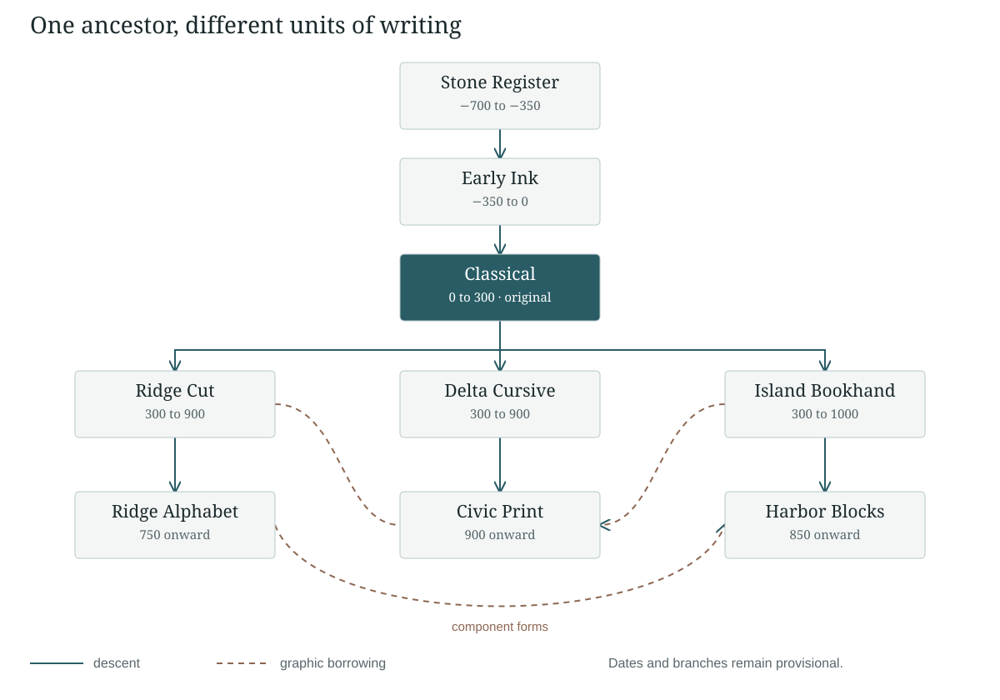
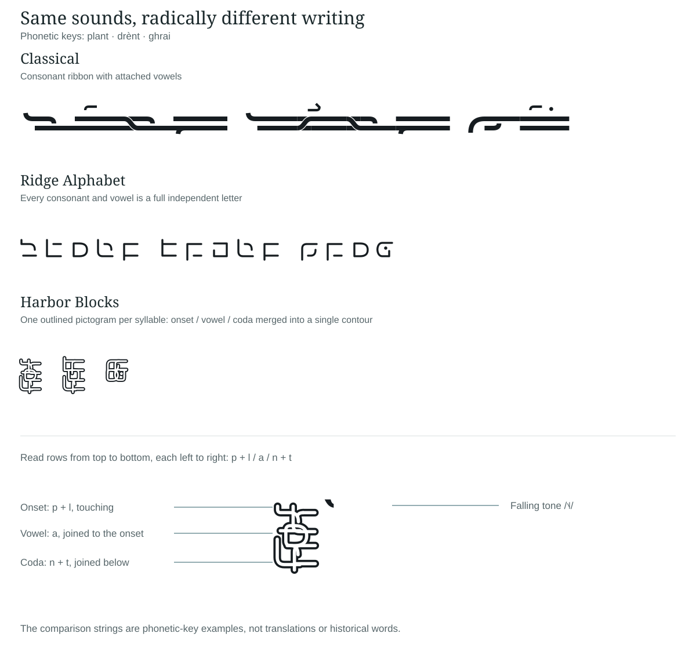

# A possible Two-Rail script family

This is a **provisional fictional history** built around Carlo's original writing system. The original drawings and the current Classical hand remain the visual authority. The earlier forms are proposed ancestors; the later forms are proposed descendants. Their dates, institutions and materials are design choices for a possible science-fiction setting, not a decipherment of the original specimen.



The setting is a connected basin with an upland watershed, a river delta and an archipelago. A shared writing school establishes a classical standard. After its network fragments, regional schools develop different habits. A later river printing standard borrows from the other two traditions. No stage is inherently better or more intelligent than another.

## Nine stages, different units of writing

Years are relative to the classical school's foundation, year 0. Ranges describe a hand's characteristic period, not a sudden replacement of all earlier writing.

| ID | Hand | Period | Parent | Medium and principal innovation |
| --- | --- | --- | --- | --- |
| stone | Stone Register | −700 to −350 | — | Incised surfaces: independent signs, angular bends, diamond punctures |
| reed | Early Ink | −350 to 0 | Stone | Prepared sheets: rounded returns and pen stops; signs remain independent |
| classical | Classical | 0 to 300 | Early Ink | The original hand: continuous rails, genuine S-switches, visible branching legs |
| ridge | Ridge Cut | 300 to 900 | Classical | Cut labels: resegmented signs, chamfers, beaked returns, diamond marks |
| delta | Delta Cursive | 300 to 900 | Classical | Quick contracts: continuous rails, open oblique returns, oval pen marks |
| island | Island Bookhand | 300 to 1000 | Classical | Bound manuscripts: broad return bowls, inward feet, rounded closing bars |
| civic | Civic Print | 900 onward | Delta | Reusable type: open returns with explicit feet and repeatable chamfers; graphic borrowing from Ridge and Island |
| ridge-alpha | Ridge Alphabet | 750 onward | Ridge | Full independent consonant **and vowel letters**, with the guide rails removed |
| harbor | Harbor Blocks | 850 onward | Island | Fused syllable signs: onset, vowel and coda joined where their strokes meet |

Solid edges in the tree are descent. Dashed edges are graphic borrowing. Civic has one Delta parent; borrowing a letter shape does not make it the genealogical child of three spoken languages.

## A comparative plate


Every row draws **the same modern keys**: `din rento ghma`, then `n p s r w`. In Harbor, the second row has explicitly marked vowelless clusters; the crossed empty-nucleus square does not supply a schwa. These are neutral comparison strings, not translations or reconstructed historical words. Using a shared key set makes the shapes comparable; it does not claim that every modern sound or allograph existed at the earliest stage.

The editor's Classical rendering is unchanged. The first seven profiles develop its drawing conventions. The two new structural descendants instead change the unit of writing: a full phoneme letter or a compound syllable sign. All retain the input sound sequence and the eight approved tone/stress meanings. Historical spelling and phonological conversion remain separate tasks; selecting a script does not translate or merge the user's sounds.

## How the forms develop

### Stone → Early Ink: a change in ductus

“Ductus” means the habitual way a sign is executed. In the proposed Stone hand, the writer lifts a cutting tool between signs and approximates bends with short straight cuts. Dots become diamond punctures. The two levels begin as ruled guides, with the direction of a returning stroke carrying a stable distinction.

Early Ink keeps the separate signs but rounds the returns and pen stops. This is more than thinning the current font: letters are detached, cuts become curves, and marks recover round forms. A tool change motivates a possibility; it does not mechanically determine what every writer must do.

### Early Ink → Classical: a school standard

Repeated straight entries join neighboring rails. Actual upper-to-lower and lower-to-upper transfers become smooth S-curves. Outside legs remain recognizable, branching from an available incoming rail. Internal returns still distinguish letter families.

The original hand sits here as the reference form. It is not redrawn to make the invented ancestors seem inevitable. An alternative history could place it elsewhere; this first model deliberately gives it a central, conservative teaching role.

### Classical → Ridge: resegmentation and convergence

Ridge cutters separate the word ribbon into individual signs again. Curves become chamfered paths; return hooks turn into short angular beaks; round marks become diamonds. Both the loss of joining and the changed internal geometry are visible in the plate.

Ridge consequently looks older than its date. That is a philological trap: its angularity resembles Stone through a renewed cutting practice. It retains later distinctions, so it is not drawn as Stone's separate surviving sister. A family tree should follow inherited innovations rather than one conspicuous resemblance.

### Classical → Delta: abbreviated returns

The rails remain continuous, while terminal bowls open into oblique strokes. Round pen marks stretch to ovals. Upper and lower hooks keep their opposite orientation, so the abbreviation retains the information needed to tell their families apart.

The prototype does not simulate omitted predictable vowels or tones. That would require a specified language, context and recovery rules. All typed marks remain visible. A quick hand can need a contrastive diacritic even when some consonant strokes become simpler.

### Classical → Island: conservative text, distinctive allographs

Island copyists broaden the return bowls and add a short inward foot. Closing bars receive rounded ends. These are changes to the allographs—the written forms of the same signs—rather than changes to the sound table.

This branch is meant to support conservative manuscript spellings. Conservatism and visual stasis are different: a manuscript tradition may preserve a spelling while developing a strongly recognizable hand.

### Delta → Civic: standardization with contact

Civic retains Delta's open returns. It adds short horizontal feet, inspired by Island book copying, and regular chamfers associated with Ridge cutting. The result can be cut and reused without losing the running band's structure.

The dashed contact edges are essential. Similar shapes can be inherited, borrowed, independently reinvented, or deliberately restored. A later public standard is not necessarily an unbroken survival of the classical spoken language.

## Structural divergence: alphabet and syllable seals



### Ridge → Ridge Alphabet: vowels become ordinary letters

Ridge primers shorten each consonant to its diagnostic joint, removing the long guide rails. The seven inherited special initial-vowel forms become ordinary baseline letters; the four vowels that lacked a dedicated initial form are enlarged and stabilized from their former marks. Every written consonant and vowel now occupies an independent letter position. Vowels are never implicit or merely attached above a consonant.

This is a **pure segmental alphabet** in the normalized key system. `plant` is five letters: p + l + a + n + t. `gh`, `c`, and `g` each produce a single consonant letter for /ɡ/, /tʃ/, and /dʒ/ respectively, because the input labels denote sounds rather than English spelling. Tone and stress remain prosodic marks, which does not make the vowel letters dependent on consonants. The alphabet compares all 31 current consonant/vowel values; a particular fictional spoken variety need not use all of them natively.

Promoting initial-vowel allographs provides a historical bridge to full vowels rather than introducing eleven arbitrary modern letters at once. Detaching each consonant's joint accounts for recognizable family resemblances after the word ribbon disappears.

### Island → Harbor Blocks: the syllable becomes one compound sign

Frequent Island ligatures initially bind a vowel and its neighboring consonants into small seals. A later teaching reform regularizes them into a **fused syllable sign**. It borrows recognizable sound forms from Ridge Alphabet without adopting alphabetic writing. This is graphic contact, not a new spoken-language parent.

- **Top row:** onset consonants, left to right.
- **Middle row:** full vowel components, left to right.
- **Bottom row:** coda consonants, left to right, in the same orientation as onsets.
- **Outside the sign:** tone and secondary-stress signs at the right; primary stress above.

Harbor copyists also **simplify the borrowed letters**. A consonant keeps the stroke that carries its stem. Its detached second stroke is dropped wherever the letter stays distinct, or joined into the stem stroke where it would otherwise be confused with another letter. Every component becomes one continuous shape, so a consonant-vowel sign is two merged lines rather than three or four. Nothing encloses the components. Copyists round every straight corner, so the borrowed alphabet forms become a softer, more organic hand. Each component nestles against its neighbour. A consonant's lower rail and a flat vowel top merge into one shared stroke, so `pa` reads as a single sign. Where two components still do not touch, a free stroke end that points toward the other flows into it in a short curved ligature, as a pen would without lifting. The ligature is a join, not a sound, and it never crosses another stroke. Finally, the whole syllable is drawn as a single outlined pictogram. Its components overlap, and their strokes merge into one continuous hollow contour, so the eye reads one emblem whose internal shapes still spell the sounds. Rows interpenetrate by a limited amount, so every sound shape stays traceable inside the merged outline. The sign is a constant 88 units tall and as wide as its fused components. Up to **three onset consonants, two vowels and three coda consonants** fit without reducing component size. `plant` contains five sounds in one cell; `strant` has three initials and two finals; `ghrai` has two initials and two vowels. Rows are centred on a common axis. Empty onset and coda positions remain blank. Paired components touch without crossing, and strokes are shared only where they run parallel.

An earlier version enclosed the vowels in a two-rail chamber with separated components; it read as three boxed rows rather than one sign. Before that, a rejected spine-and-shoulder prototype had small gates and mirrored roots that were difficult to distinguish. The current signs keep one recognisable, simplified shape per sound and one reading order. Components in the palette show those shapes in a tight frame, not a miniature complete block surrounded by empty space.

The inspiration from Korean concerns **composing consonant/vowel components into a syllable block**. Unicode describes Hangul's leading-consonant, vowel and trailing-consonant classes in its [Korean FAQ](https://www.unicode.org/faq/korean.html). Harbor uses its own softened letters merged into outlined pictograms, with shared rails and curved ligatures, three horizontal registers, and separate prosody. It does not use Korean jamo or Korean syllabification rules.

See the [complete Harbor diagnostic plate](evolution/harbor-diagnostics.svg) for all consonants in both positions, all eleven vowels, compound vowels in opposite orders, empty positions, clusters and combined tone/stress.

### Boundaries are explicit when needed

The editor uses a declared **graphic default**, not a universal pronunciation rule: consecutive vowels share a nucleus; the last consonant between nuclei begins the next group. Thus `rento` becomes `ren·to`, and `katra` becomes `kat·ra`.

Use a middle dot to override it: `ka·tra` gives the second sign an initial `tr` cluster. `kai` shares one compound core, while `ka·i` creates two symbols. In the alphabet these boundaries do not alter the letter sequence. The middle dot is a structural input control for the new descendants; in older hands it remains visible as an unassigned character, so the source is never silently rewritten.

A string without a written vowel has a **small crossed square in the vowel row**, visibly different from schwa. It preserves the consonants as an unresolved/vowelless cluster and produces a placement note. That is not an assertion that the cluster is a spoken syllable. Graphic capacity for a cluster does not establish that a fictional language permits it.

The new systems have their own glyph layout rather than transforming the old SVG. Long words wrap between letters or syllable signs. A group exceeding three onsets, two vowels or three codas uses a **bracketed alphabetic spell-out** at a constant readable size, wrapping between letters; it does not invent another syllable or shrink a huge cluster to a dot. More than eight prosodic annotations continue in separate bounded annotation tiles. The source grouping and every mark remain intact. Initial-vowel and joining controls are unavailable where the writing system determines those choices. All source sounds, unknown characters, stress and tone marks are retained.

## What is implemented

- Nine selectable historical stages in **Appearance → Historical hand**.
- A script-history explorer opened by the current hand's name next to Preview.
- Stage-aware consonant, vowel and mark previews, SVG/PNG export, document saving and offline copies.
- A reproducible atlas and family tree, generated from the same profile data as the editor.
- Exact preservation of the Classical SVG when no historical profile is requested.

The older profiles change joining practice, curve geometry, terminal-return allographs, closing bars and round marks. The alphabet and syllable branch add new layouts and explicit sound-component inventories. The core Classical engine and original images remain unchanged. In traditions with intrinsic grouping, the Join letters control is unavailable; initial-vowel choices also become unavailable in the two structural descendants.

The date ranges and fully normalized repertoire are useful editorial scaffolding. They are not an archaeological corpus, an argument that every change is inevitable, or a complete font with context-specific handwriting variants. In particular, material alone does not determine script shape.

## Philological notes for later refinement

- Add transitional witnesses instead of making every innovation simultaneous.
- Distinguish a cursive personal hand from the regional school's book standard.
- Record spelling conservatism separately from the contemporary pronunciation.
- Mark loans and restorations instead of forcing every resemblance into a descent tree.
- Reassess contrast after each simplification; a fast hand still has to distinguish signs its readers need.
- Derive new tone spellings only alongside explicit linguistic changes, keeping the approved pitch/stress values stable.

## Real-method background

The fiction takes methodological cues from real writing history; it does not copy an actual script's genealogy. The [Metropolitan Museum's early tablet record](https://www.metmuseum.org/art/collection/search/327384) describes the physical difference between drawing proto-cuneiform signs and impressing a wedge-shaped stylus. That is a concrete example of tool practice shaping strokes, not proof that a specific medium universally produces our proposed forms.

For a compact account of comparative reconstruction, the [UCSB historical-reconstruction guide](https://hlw.id.ucsb.edu/sites/default/files/2024-04/Ch12_GuideHistoricalReconstruct.pdf) emphasizes deriving correspondences with regular, explicitly conditioned changes. Here the same discipline motivates declared transformations and separate inheritance/contact edges. The proposed dates, branches and glyph transformations above remain original fictional design.

## Rebuild

```sh
node scripts/build-evolution.cjs
python3 build.py
node --test tests/engine.test.cjs tests/phonetics.test.cjs tests/evolution.test.cjs tests/descendants.test.cjs
```

`src/evolution.js` contains the public genealogy and the older drawing rules. `src/descendants.js` defines the full alphabet, shared Harbor sound components, fused three-row syllable signs, syllable grouping and new layouts. `scripts/build-evolution.cjs` reads only the public engine and profiles. The standalone HTML embeds them; it does not fetch external assets or read local language drafts.
