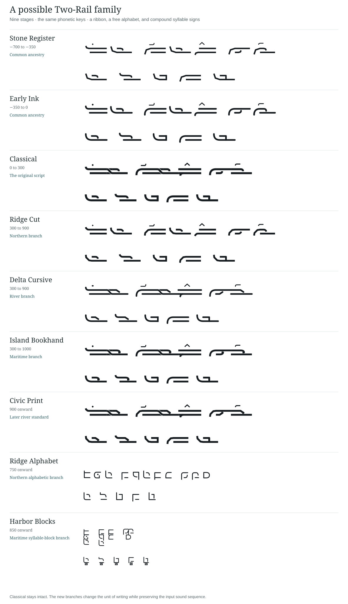

# A possible Two-Rail script family

This is a **provisional fictional history** built around Carlo's original writing system. The original drawings and the current Classical hand remain the visual authority. The earlier forms are proposed ancestors; the later forms are proposed descendants. Their dates, institutions and materials are design choices for a possible science-fiction setting, not a decipherment of the original specimen.


The setting is a connected basin with an upland watershed, a river delta and an archipelago. A shared writing school establishes a classical standard. After its network fragments, regional schools develop different habits. A later river printing standard borrows from the other two traditions. No stage is inherently better or more intelligent than another.

## Eleven stages, different units of writing

Years are relative to the classical school's foundation, year 0. Ranges describe a hand's characteristic period, not a sudden replacement of all earlier writing.

| ID | Hand | Period | Parent | Medium and principal innovation |
| --- | --- | --- | --- | --- |
| stone | Stone Register | −700 to −550 | — | Incised surfaces: free-standing consonant letters cut straight; a vowel after a consonant is a small raised letter |
| ridge-alpha | Ridge Alphabet | −550 to −350 | Stone | Upland tallies: raised vowels grow into full letters; every sound has an independent letter |
| capitals | Upland Capitals | −350 onward | Ridge Alphabet | Monuments and painted signs: one unbroken stroke per sound, in capital-letter proportions |
| ridge | Ridge Cut | −550 to −350 | Stone | Narrow labels: signs hung on two ruled rails; chamfers, beaked returns, diamond marks; vowels become marks |
| reed | Early Ink | −350 to 0 | Ridge Cut | Prepared sheets: a reed pen rounds the chamfers into curved returns; signs remain independent |
| seal | Reed Seals | 0 to 850 | Early Ink | Carved seals: one cell per syllable, with sounds stacked around a two-rail vowel chamber |
| classical | Classical | 0 to 300 | Early Ink | The original hand: continuous rails, genuine S-switches, visible branching legs |
| delta | Delta Cursive | 300 to 900 | Classical | Quick contracts: a forward-slanting cursive with rounded turns, open returns and word-final exit strokes |
| island | Island Bookhand | 300 to 1000 | Classical | Bound manuscripts: broad return bowls and inward feet; vowels drawn with Harbor Blocks shapes over the Classical ribbon |
| harbor | Harbor Blocks | 850 to 1300 | Reed Seals | Fused syllable pictograms: onset, vowel and coda merged into one outline; borrows from Ridge Alphabet |
| roundel | Harbor Roundels | 1300 onward | Harbor Blocks | One open pen circle per syllable, vowel inside, single-stroke consonants on the rim; ring-and-stroke ideograms for frequent words |

Solid edges in the tree are descent. Dashed edges are graphic borrowing: Island Bookhand takes vowel shapes from Harbor Blocks, and Harbor takes simplified sound forms from the Ridge Alphabet. Borrowing a shape does not change a script's parent.

## A comparative plate



Every row draws **the same modern keys**: `din rento ghma`, then `n p s r w`. In Harbor, the second row has explicitly marked vowelless clusters; the crossed empty-nucleus square does not supply a schwa. These are neutral comparison strings, not translations or reconstructed historical words. Using a shared key set makes the shapes comparable; it does not claim that every modern sound or allograph existed at the earliest stage.

The editor's Classical rendering is unchanged. Ridge Cut, Early Ink, Delta and Island develop its drawing conventions. The structural hands change the unit of writing instead: an incised proto-alphabet, two full alphabets, syllable cells, fused syllable pictograms, and circles with ideograms. All retain the input sound sequence and the eight approved tone/stress meanings. Historical spelling and phonological conversion remain separate tasks; selecting a script does not translate or merge the user's sounds.

## How the forms develop

### The Stone Register: halfway to an alphabet

The earliest hand is a set of free-standing consonant letters cut with a square tool. The cutter approximates every curve with two straight cuts and punches dots as diamonds. Vowels are already written, but a vowel that follows a consonant is a small letter raised over that consonant's shoulder. Only a vowel that begins a syllable is cut at full size. The register therefore sits between its two daughters. The Ridge Alphabet gives every sound a full letter. Ridge Cut reduces vowels to marks on their consonant, which leads through Early Ink to the Classical ribbon.

### Stone → Ridge Alphabet: vowels become ordinary letters

Upland tally keepers need names and loans spelled sound by sound. They let the raised vowels grow into full letters on the line and relax the square cuts into a light, even stroke. Every written consonant and vowel now occupies an independent letter position. This is a **pure segmental alphabet** in the normalized key system. `plant` is five letters: p + l + a + n + t. `gh`, `c` and `g` each produce a single consonant letter, because the input labels denote sounds rather than English spelling. Tone and stress remain prosodic marks. Its language, Old Upland Talar, splits from Proto-Talar and never passes through the Early or Classical stages.

### Ridge Alphabet → Upland Capitals: one stroke per sound

Upland stonecutters and sign painters make each Ridge Alphabet letter with a single chisel run or brush pull. Every consonant reduces to one unbroken stroke that keeps its stem direction; every vowel is already one stroke. The letters narrow and lengthen into capital proportions, with square ends and a dotted i that is distinct from j. The result resembles a Latin alphabet more than its ancestors do. The script never passes through the ink school.

### Stone → Ridge Cut → Early Ink: rails, then a reed

Lowland label cutters write long and narrow. They hang every Stone sign on the same two ruled rails, cut curves as chamfers, turn hooks into short beaks and punch round marks as diamonds. Raised vowels shrink into marks over their consonant. This consonant-and-mark structure is what every Classical-related script inherits.

“Ductus” means the habitual way a sign is executed. Early Ink scribes write with a reed. They keep Ridge Cut's separate signs and rails but round the chamfers back into curved returns and pen stops. A tool change motivates a possibility; it does not mechanically determine what every writer must do.

### Early Ink → Classical: a school standard

Repeated straight entries join neighboring rails. Actual upper-to-lower and lower-to-upper transfers become smooth S-curves. Outside legs remain recognizable, branching from an available incoming rail. Internal returns still distinguish letter families.

The original hand sits here as the reference form. It is not redrawn to make the invented ancestors seem inevitable. An alternative history could place it elsewhere; this first model deliberately gives it a central, conservative teaching role.


### Classical → Delta: a true cursive

Contract writers never lift the pen inside a clause. Each letter slants forward about its own origin, so the rails still meet from letter to letter. Every corner becomes a curve and terminal bowls open into oblique strokes. The last letter of each word leaves the line with a rising exit stroke. Round pen marks stretch to ovals. Upper and lower hooks keep their opposite orientation, so the speed loses none of the information needed to tell letter families apart. All typed vowels and marks remain visible.

### Classical → Island: conservative text, borrowed vowels

Island copyists broaden the return bowls and add a short inward foot. Closing bars receive rounded ends. Late copyists, in contact with Harbor writing, replace the thin Classical vowel diacritics with the compact vowel shapes of Harbor Blocks. They set these over the ribbon in the same positions. The consonant ribbon, rails and joins stay Classical. These are changes to the allographs, the written forms of the same signs, not changes to the sound table. They show how a conservative manuscript tradition can still borrow from a neighbour.


## Structural divergence: alphabets, syllable cells and circles


### Early Ink → Reed Seals: the first syllable cells

A seal must hold a whole name in a small square. Coastal carvers working from Early Ink models therefore stack each syllable into one cell instead of running sounds along a line. Initial consonants go above, final consonants below, and the vowels sit between two short rails, the last trace of Early Ink's guide lines. Every component keeps its full sound shape at a constant size. This is the old boxed three-row cell, and it sits halfway between the ink line and the later Harbor pictograms. The seals record Early Talar formulas and keep those spellings for centuries.

### Reed Seals → Harbor Blocks: the syllable becomes one compound sign

Harbor schools take the seal cell into everyday writing. They drop the rail chamber and regularize each syllable into a **fused syllable sign**. Their speakers' language descends from Island Talar, so the script and the language have different parents. This is a clear case of writing transmitted by an institution rather than by a speech community. It borrows recognizable sound forms from the Ridge Alphabet without adopting alphabetic writing. This is graphic contact, not a new spoken-language parent.

- **Top row:** onset consonants, left to right.
- **Middle row:** full vowel components, left to right.
- **Bottom row:** coda consonants, left to right, in the same orientation as onsets.
- **Outside the sign:** tone and secondary-stress signs at the right; primary stress above.

Harbor copyists also **simplify the borrowed letters**. A consonant keeps the stroke that carries its stem. Its detached second stroke is dropped wherever the letter stays distinct, or joined into the stem stroke where it would otherwise be confused with another letter. Every component becomes one continuous shape, so a consonant-vowel sign is two merged lines rather than three or four. Consonant clusters go further. Each member becomes a small single-stroke sign, and the cluster reads as a row of separate strokes resting on or hanging from the vowel. Nothing encloses the components. Copyists round every straight corner, so the borrowed alphabet forms become a softer, more organic hand. Each component nestles against its neighbour. A consonant's lower rail and a flat vowel top merge into one shared stroke, so `pa` reads as a single sign. Where two components still do not touch, a free stroke end that points toward the other flows into it in a short curved ligature, as a pen would without lifting. The ligature is a join, not a sound, and it never crosses another stroke. Finally, the whole syllable is drawn as a single outlined pictogram. Its components overlap, and their strokes merge into one continuous hollow contour, so the eye reads one emblem whose internal shapes still spell the sounds. Rows interpenetrate by a limited amount, so every sound shape stays traceable inside the merged outline. The sign is a constant 88 units tall and as wide as its fused components. Up to **three onset consonants, two vowels and three coda consonants** fit without reducing component size. `plant` contains five sounds in one cell; `strant` has three initials and two finals; `ghrai` has two initials and two vowels. Rows are centred on a common axis. Empty onset and coda positions remain blank. Paired components touch without crossing, and strokes are shared only where they run parallel.

An earlier version enclosed the vowels in a two-rail chamber with separated components; it read as three boxed rows rather than one sign. Before that, a rejected spine-and-shoulder prototype had small gates and mirrored roots that were difficult to distinguish. The current signs keep one recognisable, simplified shape per sound and one reading order. Components in the palette show those shapes in a tight frame, not a miniature complete block surrounded by empty space.

The inspiration from Korean concerns **composing consonant/vowel components into a syllable block**. Unicode describes Hangul's leading-consonant, vowel and trailing-consonant classes in its [Korean FAQ](https://www.unicode.org/faq/korean.html). Harbor uses its own softened letters merged into outlined pictograms, with shared rails and curved ligatures, three horizontal registers, and separate prosody. It does not use Korean jamo or Korean syllabification rules.

See the [complete Harbor diagnostic plate](evolution/harbor-diagnostics.svg) for all consonants in both positions, all eleven vowels, compound vowels in opposite orders, empty positions, clusters and combined tone/stress.

### Harbor Blocks → Harbor Roundels: circles and ideograms

Late Harbor Talar wears most words down to a single syllable, and homophones multiply: tun means both “person” and “perceive”. Ledger writers answer with a quicker, rounder hand. Every syllable becomes an **open pen circle**, started at the upper right and stopped just short of its start. The vowel sits inside it, and single-stroke consonants rest on the rim above (onset) or hang from it below (coda). Frequent words get **ideograms**, written in the editor as `#word`. These are not pictures: each is a closed ring plus one or two abstract strokes in the same pen, so they read as part of the writing.

| Typed | Ideogram | Meaning |
| --- | --- | --- |
| `#tun` | ring with a descending stroke | person |
| `#lon` | ring with two bars | record |
| `#nèl` | ring with a wave | water |
| `#tas` | ring with ticks above and below | stone |
| `#we` | double ring | seen (direct evidence) |
| `#wu` | slashed ring | not |
| `#ru` | ring with a cross | every |
| `#su` | ring with one bar | some |
| `#na` | ring between two uprights | name |

So `#ru #tun lon tun` writes “every person perceives some record”: the ideogram distinguishes person from the spelled-out tun, perceive. An unrecognized `#` stays visible as an unknown sign. Ideograms are a writing convention keyed to the typed word. The renderer still never translates text or applies sound laws.

### Boundaries are explicit when needed

The editor uses a declared **graphic default**, not a universal pronunciation rule: consecutive vowels share a nucleus; the last consonant between nuclei begins the next group. Thus `rento` becomes `ren·to`, and `katra` becomes `kat·ra`.

Use a middle dot to override it: `ka·tra` gives the second sign an initial `tr` cluster. `kai` shares one compound core, while `ka·i` creates two symbols. In the alphabet these boundaries do not alter the letter sequence. The middle dot is a structural input control for the new descendants; in older hands it remains visible as an unassigned character, so the source is never silently rewritten.

A string without a written vowel has a **small crossed square in the vowel row**, visibly different from schwa. It preserves the consonants as an unresolved/vowelless cluster and produces a placement note. That is not an assertion that the cluster is a spoken syllable. Graphic capacity for a cluster does not establish that a fictional language permits it.

The new systems have their own glyph layout rather than transforming the old SVG. Long words wrap between letters or syllable signs. A group exceeding three onsets, two vowels or three codas uses a **bracketed alphabetic spell-out** at a constant readable size, wrapping between letters; it does not invent another syllable or shrink a huge cluster to a dot. More than eight prosodic annotations continue in separate bounded annotation tiles. The source grouping and every mark remain intact. Initial-vowel and joining controls are unavailable where the writing system determines those choices. All source sounds, unknown characters, stress and tone marks are retained.

## What is implemented

- Eleven selectable historical stages in **Appearance → Historical hand**.
- A **Scripts and languages** explorer opened by the current hand's name next to Preview. Each stage shows its script history and the philology of its spoken variety: sound changes, grammar type, word division, cognates and example sentences drawn in that hand. Ordinary Delta, for example, appears as unspaced cursive and Island as long agglutinated words.
- Stage-aware consonant, vowel and mark previews, SVG/PNG export, document saving and offline copies.
- A reproducible atlas and family tree, generated from the same profile data as the editor.
- Exact preservation of the Classical SVG when no historical profile is requested.

The older profiles change joining practice, curve geometry, terminal-return allographs, closing bars and round marks. The alphabet and syllable branch add new layouts and explicit sound-component inventories. The core Classical engine and original images remain unchanged. In traditions with intrinsic grouping, the Join letters control is unavailable; initial-vowel choices also become unavailable in the two structural descendants.

The date ranges and fully normalized repertoire are useful editorial scaffolding. They are not an archaeological corpus, an argument that every change is inevitable, or a complete font with context-specific handwriting variants. In particular, material alone does not determine script shape.

## Philological notes for later refinement

- Add transitional witnesses instead of making every innovation simultaneous.
- Distinguish a cursive personal hand from the regional school's book standard.
- Record spelling conservatism separately from the contemporary pronunciation.
- Mark loans and restorations instead of forcing every resemblance into a descent tree.
- Reassess contrast after each simplification; a fast hand still has to distinguish signs its readers need.
- Derive new tone spellings only alongside explicit linguistic changes, keeping the approved pitch/stress values stable.

## Real-method background

The fiction takes methodological cues from real writing history; it does not copy an actual script's genealogy. The [Metropolitan Museum's early tablet record](https://www.metmuseum.org/art/collection/search/327384) describes the physical difference between drawing proto-cuneiform signs and impressing a wedge-shaped stylus. That is a concrete example of tool practice shaping strokes, not proof that a specific medium universally produces our proposed forms.

For a compact account of comparative reconstruction, the [UCSB historical-reconstruction guide](https://hlw.id.ucsb.edu/sites/default/files/2024-04/Ch12_GuideHistoricalReconstruct.pdf) emphasizes deriving correspondences with regular, explicitly conditioned changes. Here the same discipline motivates declared transformations and separate inheritance/contact edges. The proposed dates, branches and glyph transformations above remain original fictional design.

## Rebuild

```sh
node scripts/build-evolution.cjs
python3 build.py
node --test tests/engine.test.cjs tests/phonetics.test.cjs tests/evolution.test.cjs tests/descendants.test.cjs
```

`src/evolution.js` contains the public genealogy and the older drawing rules. `src/descendants.js` defines the full alphabet, shared Harbor sound components, fused three-row syllable signs, syllable grouping and new layouts. `scripts/build-evolution.cjs` reads only the public engine and profiles. The standalone HTML embeds them; it does not fetch external assets or read local language drafts.
