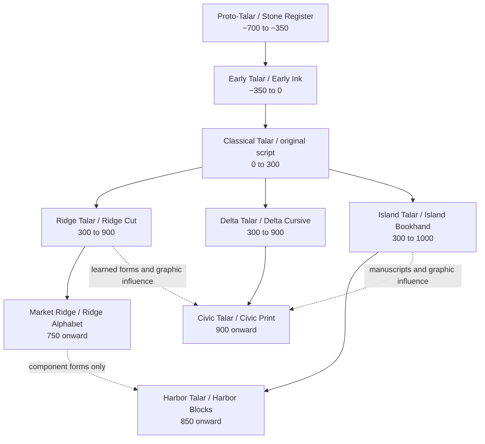

# One spoken family, several written traditions

**LOCAL LANGUAGE DRAFT.** Years are relative to the establishment of the Classical writing school. The setting, people, language names and events are provisional. This is a constructed scenario, not a real historical reconstruction.

Solid edges are the proposed inheritance tree. Dashed edges are contact, textual transmission or standardization. Civic is a later Delta variety; it is not the genetic child of three languages. A script can be borrowed without the borrower changing language, and the same spoken variety can use a formal hand and a quick hand. The paired labels above are historical associations, not a claim of one-to-one correspondence.

## The provisional setting

A connected basin contains an upland watershed, a populous river delta and an archipelago of ports. Early communities record measures and boundaries. A transregional school develops a deliberately explicit agreement register out of ordinary speech. Its texts travel with surveyors, negotiators and apprentices, while its everyday varieties keep changing.

Around year 300, the common school network fragments after a sequence of floods and political reorganizations. No language changes overnight. Ridge administrations train local cutters; delta trading houses train rapid copyists; island libraries circulate bound copies. These institutions reinforce already developing regional habits. Their tools constrain writing, not the speakers' intelligence or grammatical sophistication.

## Common stages and ordered sound changes

Forms are given in editor spelling, with IPA in the rules. `*` marks a fictional reconstructed ancestor. `model.cjs` applies the following in order to the seed lexicon, not word by word through ad hoc substitutions.

### stone: Proto-Talar, −700 to −350

Citation forms are the proto entries in `lexicon.json`. Basic vowels are /a e i o u ə/; roots have initial stress. The learned prefix operators and participant labels are already being conventionalized in oral agreements, alongside less explicit conversation. The Stone writing stage is **not** a claim that writing began as a fully designed predicate calculus.

The first two ruled levels were counting and alignment aids. Repeated returning strokes distinguish consonant families. Vowels are supplied explicitly in careful records. The comparative rendering provides normalized shapes for the modern repertoire, including signs that would be later innovations; it is not an authentic-looking deciphered inscription.

### reed: Early Talar, −350 to 0

Shared innovation E1: `/w/ → /v/ / _u` within a lexical word: `*wuna → vuna` “bind”. The other sample roots retain their citation segments at this stage. This limited change is intentional: adopting ink does not require a wholesale new phonology.

Logical expressions remain analytic. Performance conventions help listeners identify the scope of a prefix before a written punctuation system develops. Curves and round stops enter the script as copyists change tools. The agreement register spreads between communities; that is contact-mediated standardization, not necessarily proof that every local speaker descends from a single engineered dialect.

### classical: Classical Talar, 0 to 300

Apply C1–C3 after E1:

1. C1: `tj dj sj zj → c g ş ž`, i.e. `/tj dj sj zj/ → /tʃ dʒ ʃ ʒ/`.
2. C2: `a u o → æ y œ` immediately before /j/, or before one consonant followed by /i/ or /j/. The conditioning vowel/glide is retained in these normalized examples.
3. C3: `e o → è ò` before a **word-final** /r/ or /l/.

Thus `*tuni → tyni`, `*loni → lœni`, `*kani → kæni`, `*ner → nèr`, `*lor → lòr`. C1 precedes C2: `*tja → ca`, not `cæ`. The loss of the glide in coalescence removes the later conditioning environment. These order-sensitive results make the model more than a collection of visual renamings.

The three fronted vowels are surface distinctions in this small dataset. A larger corpus, paradigms, loans and changes that erase their conditioning environments are needed to determine when all become independently contrastive. The writing school can record phonetic distinctions before a later phonemic analysis is settled.

The school fixes named participant places and explicit logical scopes in contracts. The script's flowing rail joins become standard. The existing high/low/contour notation can encode reading pitch, contrast and reported intention, while the external bar marks stress. It does not replace the scope words in a legal formula.

## The three daughter branches

### ridge: Ridge Talar, 300–900

**Shared innovations:** `/y/ → /i/`, `/œ/ → /ɛ/`, `/tʃ dʒ/ → /ts dz/`, and `/w/ → /v/`. Preserve /æ/, final vowels and final consonants in this sample model. Initial stress stabilizes; tone remains intonational or associated with quotation/ritual, rather than a general lexical contrast.

`tyni → tini`, `lœni → lèni`, `ca → tsa`, `ga → dza`, `waro → varo`. The /ts dz/ forms are proposals in this private language draft. The current editor draws `t+s` or `d+z`; it has no dedicated new affricate glyph.

**Grammar:** the place words move from before their argument to after it in ordinary speech, then attach as `-ta/-ti/-tu`. The fixed relation places remain recoverable. Predicate introducer `pa` becomes optional before a recognized content root. Scope operators remain separate and precede complete formulas in the careful register.

Analytical example: `tini na sara-ta na lena-ti` = Sara perceives Lena. The hyphens display morphology; they are not a new script sign. In legal copying, the older `pa … ta … ti …` spelling remains available. Suffixation is a grammatical innovation, not an output of the lexical sound-law function.

**Writing:** Ridge Cut resegments the inherited ribbon for cutting narrow labels. Its resemblance to Stone is a **reversal in writing practice**, not evidence that Ridge split before Classical. Its inherited front-vowel correspondences and affricate reflexes still place its language under Classical.

### delta: Delta Talar, 300–900

Apply D1–D4 in order:

1. `/y œ æ/ → /i e e/`.
2. `/t d/ → /r/` between vowels, after D1.
3. Delete final unstressed `/i u/` after `/m n l r/` in a lexical word that still has more than one vowel. Monosyllables are protected by that condition.
4. A vowel-final sequence `/Vs#/` passes through `/Vh#/` to `/V˦˨#/`: final /s/ disappears and falling tone becomes contrastive. The surface model writes `{3}`. This particular tonal outcome is a fictional hypothesis, not a claim that lost /s/ universally causes falling tone.

Examples: `tyni → tin`, `lœni → len`, `kæni → ken`, `mata → mara`, `pada → para`, `tas → ta{3}`. `ghœdi → gher`: fronting merger feeds lenition, which creates the sonorant environment for apocope. This is a useful diagnostic chain. It should not be replaced with an arbitrary abbreviation.

**Grammar:** frequent discourse-based omission becomes ordinary unmarked syntax. Binary clauses favor place-1–predicate–place-2 order; old place labels remain for repair, contrast and three-place predicates. Bound variables are normally replaced by discourse reference. `ru` and `su` develop into noun-phrase quantifiers. Their scopes may depend on order and topic structure, so ordinary speech no longer has the formal core's guaranteed single parse.

Normalized everyday example: `sara tin lena` = Sara perceives Lena. In a contract, `pa tin ta na sara ti na lena` restores explicit places. The formal variant is a maintained register, not the only “correct” Delta language. Negation reduces to a preverbal clitic in quick speech; the full `no` scope construction survives in teaching and dispute resolution.

**Writing:** Delta Cursive opens return bowls into obliques. Newly contrastive falling tone cannot be dropped safely from ambiguous lexical forms. A quick hand is therefore capable of **more obligatory marks** than a conservative one. The script renderer retains all marks even in contexts where a fictional casual writer might omit predictable ones.

### island: Island Talar, 300–1000

**Shared innovations:** `/y œ æ/ → /u o a/`; `/tʃ dʒ/ → /ʃ ʒ/`; intervocalic `/v/ → /w/`. Preserve final vowels. Penultimate stress replaces root-initial stress in ordinary polysyllabic words, except in learned recitation; two-syllable examples alone cannot prove the distinction.

`tyni → tuni`, `lœni → loni`, `kæni → kani`, `ca → şa`, `ga → ža`, `nava → nawa`. Island `loni` looks like Proto `*loni`, but the proposed path is `*loni → lœni → loni`. It is a **reversal**, not simple uninterrupted retention. Independent convergences must not be mistaken for shared innovations.

**Grammar:** evidence words become clause-final particles and then clitics. Every independent factual assertion normally states observation, inference or report. Embedded formulas retain their own optional evidence scope. Older `no …` gains a clause-final `vu` “false”; some everyday registers then use the final element alone. This is a proposed two-stage constructional change, not a sound law.

Normalized careful example: `pa tuni ta na sara ti na lena we` = Sara perceives Lena, with claimed direct support. Postposed `we` scopes over the completed clause. The Classical parser intentionally does not accept this daughter syntax. Evidence is socially accountable but does not make a statement true.

**Writing:** Island Bookhand broadens return bowls and adds inward feet. Manuscript witnesses often retain conservative spellings after local sounds merge. The renderer compares graphic styles under a shared modern key system; it does not silently merge c/ş or g/ž in a user's document.

## civic: Civic Talar, 900 onward

Civic descends from Delta. The current seed lexicon inherits the Delta reflexes without another arbitrary blanket sound shift. Its important innovation is register and standardization: printers and schools reintroduce full scope and place markers into an audited civic variety while ordinary speech remains largely Delta-like.

An audited Civic clause can use the Classical construction with modern `tin` and `len`. A school spelling may retain `tyni/lœni` in a quotation. These are different orthographic choices, not evidence that Civic has recovered the lost phonetic contrasts. Learned loans from Ridge and Island should be tagged as loans when the lexicon grows; they must not be made to obey native inheritance rules retroactively.

Civic Print takes its open returns from Delta, chamfers from Ridge cutting, and explicit feet from Island manuscripts. Its graphic ancestry has contact edges. Its spoken genealogy still has one Delta parent.

## How a philologist could get this wrong

1. Group Ridge with Stone because both are angular: that confuses writing technology with language descent.
2. Call Island `loni` an unchanged proto form: that ignores the Classical intermediate.
3. Group Ridge and Delta because both have /i/ for Classical /y/: the model proposes independent unrounding, so more correspondences are needed.
4. Treat Civic archaisms as living speech: conservative spelling can mask sound change.
5. Treat a formal logic register as the entire language: it suppresses the very conversational constructions that drive later change.

The seeds are proposed innovations, not enough independent evidence to reconstruct a real family. The workbook follows the discipline of deriving the stated cognates from ordered rules. For real-method background see the [UCSB comparative-method worksheet](https://hlw.id.ucsb.edu/sites/default/files/2024-04/Ch12_GuideHistoricalReconstruct.pdf) and [Rankin on the comparative method](https://onlinelibrary.wiley.com/doi/10.1002/9781405166201.ch1). The fictional dates, sound laws and institutions are our design choices.

## Two later offshoots with different writing units

The additional branches are Market Ridge under Ridge (id `ridge-alpha`) and Harbor under Island (id `harbor`). Their sound changes and writing developments are described in [structural-branches.md](structural-branches.md). A new script need not coincide with an instantaneous new language: these are proposed later varieties within the earlier branch continua.
