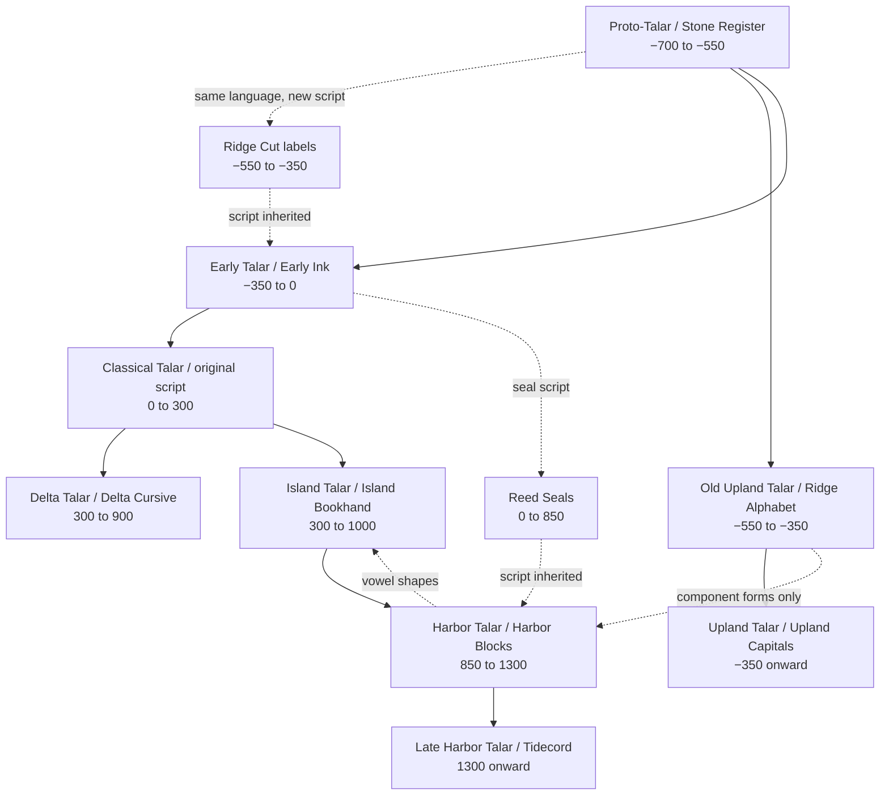

# One spoken family, several written traditions

**LOCAL LANGUAGE DRAFT.** Years are relative to the establishment of the Classical writing school. The setting, people, language names and events are provisional. This is a constructed scenario, not a real historical reconstruction.

Solid edges are the proposed inheritance tree. Dashed edges are contact, textual transmission or standardization. Ridge Cut and the Reed Seals are script stages, not languages. A script can be borrowed without the borrower changing language, and the same spoken variety can use a formal hand and a quick hand. The paired labels above are historical associations, not a claim of one-to-one correspondence.

## The provisional setting

A connected basin contains an upland watershed, a populous river delta and an archipelago of ports. Early communities record measures and boundaries. A transregional school develops a deliberately explicit agreement register out of ordinary speech. Its texts travel with surveyors, negotiators and apprentices, while its everyday varieties keep changing.

Around year 300, the common school network fragments after a sequence of floods and political reorganizations. No language changes overnight. Ridge administrations train local cutters; delta trading houses train rapid copyists; island libraries circulate bound copies. These institutions reinforce already developing regional habits. Their tools constrain writing, not the speakers' intelligence or grammatical sophistication.

## Common stages and ordered sound changes

Forms are given in editor spelling, with IPA in the rules. `*` marks a fictional reconstructed ancestor. `model.cjs` applies the following in order to the seed lexicon, not word by word through ad hoc substitutions.

### stone: Proto-Talar, −700 to −350

Citation forms are the proto entries in `lexicon.json`. Basic vowels are /a e i o u ə/; roots have initial stress. The learned prefix operators and participant labels are already being conventionalized in oral agreements, alongside less explicit conversation. The Stone writing stage is **not** a claim that writing began as a fully designed predicate calculus.

The first two ruled levels were counting and alignment aids. Repeated returning strokes distinguish consonant families. Vowels are supplied explicitly in careful records. The comparative rendering provides normalized shapes for the modern repertoire, including signs that would be later innovations; it is not an authentic-looking deciphered inscription.

### reed: Early Talar, −350 to 0

Shared innovation E1: `/w/ → /v/ / _u` within a lexical word: `*wuna → vuna` “bind”. The other sample roots retain their citation segments at this stage. This limited change is intentional: adopting ink does not require a wholesale new phonology.

Logical expressions remain analytic. Scribes write a whole formula as one continuous ink line, without word spaces. Performance conventions help listeners identify the scope of a prefix before a written punctuation system develops. Curves and round stops enter the script as copyists change tools. The agreement register spreads between communities; that is contact-mediated standardization, not necessarily proof that every local speaker descends from a single engineered dialect.

### classical: Classical Talar, 0 to 300

Apply C1–C3 after E1:

1. C1: `tj dj sj zj → c g ş ž`, i.e. `/tj dj sj zj/ → /tʃ dʒ ʃ ʒ/`.
2. C2: `a u o → æ y œ` immediately before /j/, or before one consonant followed by /i/ or /j/. The conditioning vowel/glide is retained in these normalized examples.
3. C3: `e o → è ò` before a **word-final** /r/ or /l/.

Thus `*tuni → tyni`, `*loni → lœni`, `*kani → kæni`, `*ner → nèr`, `*lor → lòr`. C1 precedes C2: `*tja → ca`, not `cæ`. The loss of the glide in coalescence removes the later conditioning environment. These order-sensitive results make the model more than a collection of visual renamings.

The three fronted vowels are surface distinctions in this small dataset. A larger corpus, paradigms, loans and changes that erase their conditioning environments are needed to determine when all become independently contrastive. The writing school can record phonetic distinctions before a later phonemic analysis is settled.

The school fixes named participant places and explicit logical scopes in contracts, and introduces word spacing so that each scope word can be audited. The script's flowing rail joins become standard. The existing high/low/contour notation can encode reading pitch, contrast and reported intention, while the external bar marks stress. It does not replace the scope words in a legal formula.

## The Classical daughters

### ridge: Ridge Cut, −550 to −350 (a script stage of Proto-Talar)

Ridge Cut is not a separate language. Lowland label cutters write Proto-Talar by hanging each Stone sign on two ruled rails and reducing raised vowels to marks. Early Ink inherits this structure, so every Classical-related script descends from it. The model's `ridge` reflex is the Proto form.

### delta: Delta Talar, 300–900

Apply D1–D4 in order:

1. `/y œ æ/ → /i e e/`.
2. `/t d/ → /r/` between vowels, after D1.
3. Delete final unstressed `/i u/` after `/m n l r/` in a lexical word that still has more than one vowel. Monosyllables are protected by that condition.
4. A vowel-final sequence `/Vs#/` passes through `/Vh#/` to `/V˦˨#/`: final /s/ disappears and falling tone becomes contrastive. The surface model writes `{3}`. This particular tonal outcome is a fictional hypothesis, not a claim that lost /s/ universally causes falling tone.

Examples: `tyni → tin`, `lœni → len`, `kæni → ken`, `mata → mara`, `pada → para`, `tas → ta{3}`. `ghœdi → gher`: fronting merger feeds lenition, which creates the sonorant environment for apocope. This is a useful diagnostic chain. It should not be replaced with an arbitrary abbreviation.

**Grammar:** frequent discourse-based omission becomes ordinary unmarked syntax. Binary clauses favor place-1–predicate–place-2 order; old place labels remain for repair, contrast and three-place predicates. Bound variables are normally replaced by discourse reference. `ru` and `su` develop into noun-phrase quantifiers. Their scopes may depend on order and topic structure, so ordinary speech no longer has the formal core's guaranteed single parse.

Normalized everyday example: `sara tin lena` = Sara perceives Lena. In a contract, `pa tin ta na sara ti na lena` restores explicit places. The formal variant is a maintained register, not the only “correct” Delta language. Negation reduces to a preverbal clitic in quick speech; the full `no` scope construction survives in teaching and dispute resolution.

**Writing:** Delta Cursive opens return bowls into obliques and writes each clause as one unbroken ribbon, `saratinlena`. The speech is isolating; the writing is not. Newly contrastive falling tone cannot be dropped safely from ambiguous lexical forms. A quick hand is therefore capable of **more obligatory marks** than a conservative one. The script renderer retains all marks even in contexts where a fictional casual writer might omit predictable ones.

### island: Island Talar, 300–1000

**Shared innovations:** `/y œ æ/ → /u o a/`; `/tʃ dʒ/ → /ʃ ʒ/`; intervocalic `/v/ → /w/`. Preserve final vowels. Penultimate stress replaces root-initial stress in ordinary polysyllabic words, except in learned recitation; two-syllable examples alone cannot prove the distinction.

`tyni → tuni`, `lœni → loni`, `kæni → kani`, `ca → şa`, `ga → ža`, `nava → nawa`. Island `loni` looks like Proto `*loni`, but the proposed path is `*loni → lœni → loni`. It is a **reversal**, not simple uninterrupted retention. Independent convergences must not be mistaken for shared innovations.

**Grammar:** evidence words become clause-final particles and then clitics. Every independent factual assertion normally states observation, inference or report. Embedded formulas retain their own optional evidence scope. Older `no …` gains a clause-final `vu` “false”; some everyday registers then use the final element alone. This is a proposed two-stage constructional change, not a sound law.

In ordinary speech the process goes further: place words become argument suffixes, and one-place content roots are incorporated into the predicate word as narrowest-scope existentials. `rutunta lontuni` means “every person perceives some record”. Island becomes the family's agglutinative, incorporating branch; see [typology.md](typology.md).

Normalized careful example: `pa tuni ta na sara ti na lena we` = Sara perceives Lena, with claimed direct support. Postposed `we` scopes over the completed clause. The Classical parser intentionally does not accept this daughter syntax. Evidence is socially accountable but does not make a statement true.

**Writing:** Island Bookhand broadens return bowls and adds inward feet. Manuscript witnesses often retain conservative spellings after local sounds merge. The renderer compares graphic styles under a shared modern key system; it does not silently merge c/ş or g/ž in a user's document.

## How a philologist could get this wrong

1. Group Ridge Cut with the Ridge Alphabet because they share a name and an angular look. Ridge Cut leads to Early Ink; the Ridge Alphabet leads to Upland Capitals.
2. Call Island `loni` an unchanged proto form: that ignores the Classical intermediate.
3. Derive Harbor Talar from the Reed Seals. The seals give Harbor its script, not its language.
4. Take Island Bookhand's Harbor-shaped vowels as evidence of Harbor ancestry. They are a late borrowing.
5. Treat a formal logic register as the entire language: it suppresses the very conversational constructions that drive later change.

The seeds are proposed innovations, not enough independent evidence to reconstruct a real family. The workbook follows the discipline of deriving the stated cognates from ordered rules. For real-method background see the [UCSB comparative-method worksheet](https://hlw.id.ucsb.edu/sites/default/files/2024-04/Ch12_GuideHistoricalReconstruct.pdf) and [Rankin on the comparative method](https://onlinelibrary.wiley.com/doi/10.1002/9781405166201.ch1). The fictional dates, sound laws and institutions are our design choices.

## Old Upland and Upland Talar: Ridge Alphabet and Upland Capitals

Old Upland Talar (id `ridge-alpha`, −550 to −350) splits from Proto-Talar before the Early stage, so it never shows the Classical fronting. One change applies: `/w/ → /v/` everywhere (`*waro → varo`). Its grammar drops `pa` and the place words. The predicate comes first and position alone fixes each place: `tuni na sara na lena` “Sara perceives Lena”. Logical operators survive as invariant free words, and `typology.cjs` parses this register into the Classical logic.

Upland Talar (id `capitals`, −350 onward) adds a second change: a final unstressed `/i u/` after a consonant reduces to schwa, written `h` (`*tuni → tunh`, `*zanu → zanh`). It keeps the positional clause: `tunh na sara na lena`. The Ridge Alphabet gives every sound a full letter; the Upland Capitals reduce each letter to one unbroken stroke.

## The Reed Seals, id seal, 0 to 850

The seals are a script branch, not a language. Coastal carvers working from Early Ink models stack each syllable into one cell. They record Early Talar formulas and keep those spellings long after the coast speaks Island and then Harbor Talar. The model's `seal` reflex is therefore the Early form.

## Late Harbor Talar and the Tidecord, id cord, 1300 onward

Late Harbor applies one further change to Harbor forms: in a polysyllable, any final vowel after a single consonant is lost (`mata → mat`, `lena → len`, `walo → wal`). Most native words become one syllable. The fused Harbor endings wear away and are replaced by free particles, so the language becomes isolating again: `sara lena tun #we` “Sara perceives Lena (I saw it)”. Homophones such as tun “person” / tun “perceive” are separated in writing by tally knots. The Tidecord descends from Harbor Blocks. Harbor clerks had long kept cargo tallies as knots on cords; ledger writers turn the shared Harbor rail into such a cord, hang each word's syllables from it, and bring the old tally knots back as ideograms. The cords themselves never wrote language, so they are an influence on the script's look, not an ancestor.

## Harbor Talar

Harbor Talar (id `harbor`) descends from Island Talar but writes with a script inherited from the Reed Seals. Its sound changes and writing are described in [structural-branches.md](structural-branches.md).
