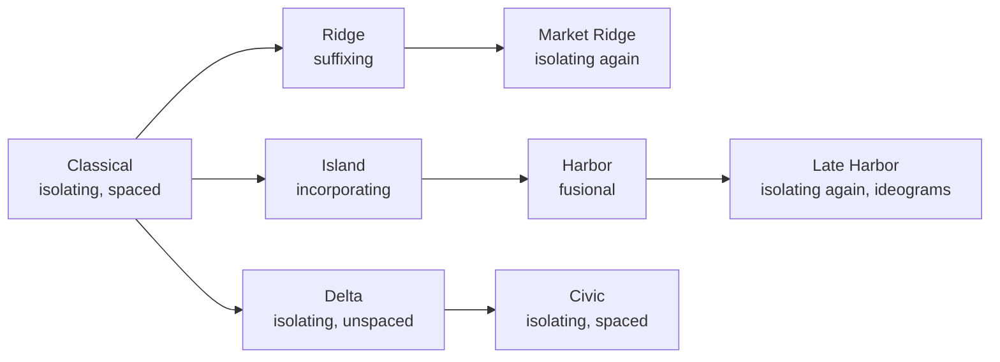

# Words, roots and spaces: how the varieties build and write a clause

**LOCAL LANGUAGE DRAFT.** This note gives each script tradition a spoken morphology and a word-division habit. The two are independent layers. A variety can glue its morphemes into long words and still space them, or keep every morpheme a free word and still write the clause as one unbroken ribbon. `typology.cjs` implements the Island and Market Ridge grammars against the Classical evaluator, segments Delta ribbons, and derives Harbor words. `specimens.cjs` regenerates the comparison sheet.

| Script | Variety | Ordinary morphology | Written word division | Sara perceives Lena |
| --- | --- | --- | --- | --- |
| Stone Register | Proto | isolating | spaced, one word per counted slot | pa tuni ta na sara ti na lena |
| Upland Capitals | Upland | isolating, predicate-final | spaced | na sara ta na lena ti tunh |
| Early Ink | Early | isolating | **continuous**, one ink line per formula | patunitanasaratinalena |
| Reed Seals | Early | isolating | spaced, one cell per syllable | pa tuni ta na sara ti na lena |
| Classical | Classical | isolating | spaced by school rule | pa tyni ta na sara ti na lena |
| Ridge Cut | Ridge | agglutinative, dependent-marking | spaced | tini nasarata nalenati |
| Delta Cursive | Delta | isolating | **continuous**, one ribbon per clause | saratinlena |
| Island Bookhand | Island | agglutinative, incorporating | spaced, long words | nasarata nalenati tuniwe |
| Civic Print | Civic | isolating | spaced by printers | pa tin ta na sara ti na lena |
| Ridge Alphabet | Market Ridge | isolating, positional | spaced | tin na sara na lena |
| Harbor Blocks | Harbor | fusional | spaced blocks | nasarata nalenati tuniw |
| Harbor Roundels | Late Harbor | isolating, monosyllabic | circles plus `#word` ideograms | sara lena tun #we |

The sheet shows the same contrast in each hand: `node drafts/language/specimens.cjs`, then `rsvg-convert drafts/language/specimens.svg -o drafts/language/specimens.png`.

## The typological drift in one picture



This follows the familiar cycle in which free words become affixes, affixes erode and fuse, and the losses are repaired with new free words. Ridge and Island take the first step in different directions. Harbor and Market Ridge each show a later stage. Delta never leaves the isolating stage. It shows that spacing is a scribal decision, not a direct consequence of grammar.

## Island: content roots inside words

Island turns the Classical evidence particles into clause-final clitics, as the history already proposes. In ordinary Island speech the process continues until a clause typically has one long predicate word and a few short argument words.

```
OPERATOR*  ARGUMENT*  PREDICATE
ARGUMENT   na-NAME-PLACE         nasarata  "Sara, place 1"
           Q-STEM-PLACE          rutunta   "every person, place 1"
PREDICATE  (STEM-)ROOT(-wu)(-te|-to)(-we|-wa|-wo)
```

`Q` is `ru` "every", `su` "some" or `mu` "which". `PLACE` is the old place word `ta/ti/tu`, now a suffix. Clause-initial `no` and `ma` survive as free words for wide-scope negation and yes/no questions.

**Incorporation.** A one-place content root can be compounded into the front of a predicate word: `lon-tuni` "record-perceive". It fills the one place that no argument word supplies. Inside a compound, Island truncates a final unstressed /i u/ after /m n l r/: `loni → lon-`, `kani → kan-`. The rule applies only in compounds, so the free word stays `loni`.

Only one-place roots incorporate or follow a quantifier, since they act as sortal restrictions. That is why the compound stem `tun-`, from `tuni` "perceive", never competes with `tun` "person".

**Scope is fixed by the grammar.** From outermost to innermost:

1. Free operators `no`, `ma`, in their written order
2. The evidence suffix. It sits at the end of the predicate word but scopes over the whole clause.
3. The tense suffix
4. Quantified argument words, leftmost widest
5. Negation `-wu`, which comes from Classical `vu` "false" by intervocalic /v/ → /w/ applied across the new morpheme boundary. Univerbation is visible in the sound change.
6. The incorporated root, always a narrowest-scope existential
7. The predicate

The incorporated root's fixed narrowest scope is not arbitrary. Incorporated nouns in real languages are characteristically non-referential and take narrowest scope. Island grammaticalizes that tendency. The result is a dense agglutinative language that remains fully parseable:

| Island | Classical equivalent | Reading |
| --- | --- | --- |
| rutunta lontuni | ru mi ki pa tun ta mi su ni ke pa lœni ta ni pa tyni ta mi ti ni | every person perceives some record, possibly a different one each |
| sulonti rutunta tuni | su ni ke pa lœni ta ni ru mi ki pa tun ta mi pa tyni ta mi ti ni | one record that every person perceives |
| rutunta lontuniwu | ru mi ki pa tun ta mi no su ni ke pa lœni ta ni pa tyni ta mi ti ni | no person perceives any record |
| no rutunta lontuni | no ru mi ki … | not every person perceives a record |
| nasarata nalenati londar | su ni ke pa lœni ta ni pa dar ta na sara ti na lena tu ni | Sara gives Lena a record |
| ma nasarata nalenati tunitewa | ma wa te pa tyni ta na sara ti na lena | did Sara (one infers) perceive Lena? |

The incorporated form cannot express the wide-scope reading. To say “one particular record”, the record must become an argument word and stand to the left. A Classical clerk gets that contrast from the order of the binders. An Island speaker gets it by choosing between a compound and a separate word. `check.cjs` runs each Island sentence and its Classical equivalent on 300 random finite models and requires identical truth values. Because the compounds contain no visible variables, the Island core cannot yet express co-reference across two predicates, as in “a record that the person made”. Classical variables remain the learned fallback.

Stress is penultimate within the whole word, so it moves as suffixes are added: `tú·ni`, `tu·ní·we`, `lon·tu·ni·té·we`. That is the phonological evidence that these units are words and not phrases. The Island compound `şa` has two readings, “hot” and “shine”, because the Island affricate merger made them homophones. The parser reports both.

**Writing:** Bookhand ribbons now run across a whole agglutinated word, so a ribbon is a morphological word, not a syllable or a phrase. Word spaces remain.

## Harbor: suffixes fuse

Harbor applies its lexical rules (/r/ → /l/ after a vowel, then final /i u/ apocope) to Island words. Apocope applies only at the end of a word, so a root keeps its vowel before a suffix:

| Island | Harbor | |
| --- | --- | --- |
| tuni | tun | bare stem, now homophonous with `tun` “person” |
| tuniwe | tuniw | stem vowel kept; `-we` contracts to `-w` after a vowel |
| tunitewe | tunitew | past + observed share one final syllable block |
| londar | londal | |

The resulting `tun ~ tuni-` alternation is the first fusional pattern. The stem no longer has a single invariant shape, and one syllable such as `tew` now carries tense and evidence together. A Harbor Block can therefore show a portmanteau inflection as one compact sign. The glyph still spells sounds, not grammar. Careful Harbor speech keeps the learned analytic sentence from [the branches note](structural-branches.md): `pa tun ta na sara ti na lenaw`.

## Ridge and Market Ridge: suffixes come and go

Ridge makes the place words into suffixes on the argument and `na` into a name proclitic: `tini nasarata nalenati`. The predicate remains a free word, and scope operators remain free prefixes. Ridge is agglutinative on the dependents but not incorporating, so it marks places on the arguments where Island builds them into the predicate.

Market Ridge, a trading lingua franca, loses the suffixes in ordinary speech. Classical prefix operators survive as invariant free words, while `pa` and the place labels disappear. Place is fixed by position: the predicate root comes first, then its arguments in place order.

```
tin na sara na lena                              Sara perceives Lena
ru mi ki tun mi su ni ke lèn ni tin mi ni        = Classical sentence A
```

Every grammatical word is free and invariant, making this the most isolating variety in the family. It is still fully parseable. Market apocope makes `nèr` "water" and `nèr` "remember" homophones, and the number of following arguments decides between them. Ridge Alphabet spacing makes each of these free words visible to learners and traders.

## Delta: isolating speech in joined writing

Delta speech stays isolating: `sara tin lena`, with omitted arguments recoverable from discourse. Delta Cursive is written for speed, so the writer lifts the pen only at a clause boundary: `saratinlena`. This writing is not agglutination. Each word is still free in speech, can be moved for focus, and takes no affixes.

Readers can separate the words because Delta function words form a small closed set of CV syllables and the content roots are short. `typology.cjs` segments a ribbon against the lexicon and the names the reader knows. In the seed lexicon, almost every ribbon has exactly one segmentation. One known clash is `saravunalena`, which can split as `sara vuna lena` "Sara binds Lena" or as `sara vu na lena`. The second split is lexically possible and grammatically empty. Lexical segmentation is not parsing, so the reader still needs grammar to choose.

Delta's real reading problem is scope, not word boundaries. A ribbon such as `rutunsulentin` cannot show which quantifier is meant to be wide. Civic Print restores spaces together with the audited prefix register. The printers' reform is about auditability, not about recovering lost words.

The falling tone mark becomes a segmentation cue as well: `ta{3}` "stone" vs the place word `ta`. Writing ribbons makes the mark even less optional.

## Early Ink: the first continuous writing

Early scribes write a whole formula as one ink line: `patunitanasaratinalena`. Their audience already knows the formula. The Classical school introduces word spacing so that every scope word can be checked at a glance. In this story, word spacing begins as a legal technology. Stone Register spacing is older and has a different origin: one slot per counted word.

## What remains open

- Island co-reference across predicates, and incorporation of two-place roots with a fixed second argument
- Harbor's full paradigm of fused endings, beyond the `-w` and `-tew` examples
- Ridge place-suffix allomorphy under later apocope
- Whether Market Ridge develops new prepositions from motion verbs such as `pada`, which would be the next turn of the cycle
- A Delta grammar that formally states its ordinary scope preferences
